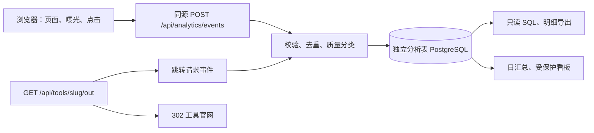

# Toools 用户行为数据采集方案

版本：v1.0 · 日期：2026-10-13 · 状态：设计方案，尚未实施

建议采用第一方显式事件采集：浏览器采集真实页面展示、推荐曝光和交互，通过同源接口写入独立的 PostgreSQL 分析表；官网跳转接口提供服务端记录。先交付覆盖全部现有页面的基础统计、事件明细查询和导出，再建立漏斗与推荐效果看板。

这份方案覆盖采集、传输、存储、指标口径、查询、实施和验收。新增管理查询界面属于后续实施范围；本文没有上线采集器、创建数据库表或读取生产数据。

## 1. 现状与目标

### 1.1 已有实现

| 当前能力 | 源码位置 | 限制 |
| --- | --- | --- |
| 工具详情累计浏览 | `src/app/tools/[slug]/page.tsx` | 服务端页面执行时递增 `Tool.viewCount`，不是客户端真实展示事件 |
| 工具官网累计跳转 | `src/app/api/tools/[slug]/out/route.ts` | GET 请求时递增 `Tool.clickCount`；没有事件时间、访客、会话、归因 |
| 热度排序及标签 | `src/app/tools/page.tsx`、`src/lib/tool-signals.ts` | 使用历史累计值，没有近期时间窗口 |
| 全站 PV/UV | 无 | 没有访客标识和页面访问明细 |
| 搜索、筛选、推荐效果 | 无 | URL 和组件状态存在，但行为没有落库 |
| 管理后台 | 无 | `robots.ts` 的 `/admin` 禁止抓取规则不代表后台已实现 |

`Tool.source/sourceUrl` 描述工具资料来源；`githubStars/phVotes` 描述第三方热度。它们不作为本站访客的渠道或行为数据。

现有两处写入未等待完成，且吞掉错误。计数更新还会触发 `Tool.updatedAt`，影响页脚和 sitemap 的内容更新时间。旧累计值无法补回历史访问明细。

### 1.2 产品问题

1. 站点每天有多少访问和独立访客，来自哪些渠道，访问哪些页面？
2. 首页哪些入口和推荐模块吸引点击，哪些模块实际被看到？
3. Stacks 是否帮助用户发现工具，哪个阶段最有价值？
4. 用户搜索什么，哪些需求无结果，哪些筛选常用？
5. 哪些工具最终获得官网导流，导流来自哪个 Stack、搜索或推荐位置？
6. 有多少用户进入 GitHub 投稿或项目支持入口？

首要业务指标定义为「每周发生至少一次有效官网跳转的会话数」。同时观察其占访问会话的比例，避免只关注流量增长。

## 2. 推荐架构与边界



- v1 沿用现有 PostgreSQL 服务，行为数据独立建表，独立查询权限；不写到 `Tool` 内容记录上。是否与业务数据库分实例，取决于上线后的实际写入量、存储量和查询负载。
- 所有业务事件显式声明。组件负责提供业务属性，共用采集 SDK 负责身份、页面上下文、传输和去重。
- 服务端组件可以输出 `data-analytics-*` 标记，由一个小型客户端桥接器监听链接、按钮、表单；已有客户端组件直接调用 SDK。每个元素只选一种事件采集方式，防止桥接器和组件重复上报。
- 自动监听页面导航；不自动抓取所有 DOM 文本、所有点击或所有表单内容。
- 浏览器事件和服务端请求事件保留不同口径，不能把 GET 请求直接等同于人类点击。
- v1 不要求重建整个内容管理后台。先提供受保护的分析页、事件明细和导出即可。
- 自建方案需要维护指标 SQL、数据质量和查询界面。若后续需要复杂实验、多人自助分析或分析负载影响主库，可把同一事件协议投递到独立分析平台；事件定义保持稳定。

## 3. 身份、时间与访问口径

### 3.1 公共标识

| 标识 | 生成和使用规则 |
| --- | --- |
| `event_id` | 每次真实事件生成 UUID；重试保持不变；数据库唯一约束用于幂等 |
| `visitor_id` | 浏览器随机标识；第一方 Cookie，建议保留 180 天；HTTPS 下设置 Secure、SameSite=Lax、Path=/；不是账户或真实自然人身份 |
| `session_id` | 同一浏览器 30 分钟无活动后开启新会话；共享会话状态保存于第一方存储，活动时间仅由可见浏览或明确交互更新 |
| `tab_id` | 每个标签页独立生成，区分同时打开的页面；持久队列重发不得改写原标签标识 |
| `page_view_id` | 每次有效页面浏览新建；页面内交互和曝光引用该值 |
| `results_id` | 每次已展示的列表结果版本新建；搜索、筛选、分页和卡片事件引用它 |
| `action_id` | 一次导航或跳转意图的关联标识，连接来源点击和目标浏览／服务端跳转 |
| `schema_version` | 事件协议版本，v1 从 1 开始；变更统计含义时增加版本 |

浏览器会话的跨标签页更新需要串行协调。优先使用浏览器支持的锁机制；不支持时以收集端返回的标准会话标识纠正冲突。服务端维护每个访客的会话活动状态，事务内判断 30 分钟超时，防止并发初始化产生多个标准会话。事件表同时保存客户端候选会话标识和标准会话标识，分析统一使用后者。

无存储权限或访客拒绝持久标识时，降级到标签页临时标识，并设置 `identity_mode=ephemeral`；不能把它和持久访客混在一起宣称精确 UV。不使用 IP 或设备指纹补齐身份。若用户选择完全停用分析，不发送行为事件。

### 3.2 页面浏览与列表更新

全站 PV 唯一来源为 `page_view`，不再另发 `tool_view/stack_view` 来重复计数。页面类型和实体字段已能表达工具／Stack 浏览。

| 情况 | 是否产生新的 `page_view` |
| --- | --- |
| 首次加载成功页面，且标签页可见 | 是，一次 |
| 客户端跳转到另一个路径，目标内容已提交且可见 | 是，一次 |
| 刷新浏览器，页面重新展示 | 是，一次 |
| `/tools` 翻到另一页并展示新结果 | 是，一次；记录 `list_page` |
| `/tools` 修改搜索、筛选或排序，仍在同一列表页 | 否；记录交互及 `results_view` |
| 筛选把当前第 3 页重置为第 1 页 | 否；它是一次筛选结果更新，不额外制造 PV |
| 浏览器后退／前进回到不同页面或列表页 | 是；回到仅搜索条件不同的相同列表页只记 `results_view` |
| BFCache 恢复到已离开的页面 | 是；更新 `page_view_id`，避免与首次挂载重复 |
| `router.refresh()` 更新同一页面数据 | 否 |
| 阶段锚点、展开收起、主题切换 | 否 |
| 页面预取、服务端渲染、构建、路由 loading | 否 |
| 背景标签页载入 | 可见后才记录第一次浏览 |
| 同一页面切到后台再切回来 | 否；不因为 visibility 切换增加 PV |
| 404、错误边界 | 记录 `page_error`；不进入正常页面 PV |
| `/api/*`、静态资源、robots、sitemap、未来管理页 | 不进入公开站点 PV |

实现时采用显式导航状态机：路径、分页、导航原因、目标内容 ready 状态共同决定页面事件。单独监听 `pathname` 无法区分分页，监听整个 query 又会把搜索输入制造为 PV。搜索／筛选改变时更新列表上下文，但保留当前页面浏览标识。

两次离散访问同一路径可以产生两条 PV；防重按 `page_view_id/event_id`，不能永久按 URL 去重。客户端重复挂载和 effect 重跑不得产生额外浏览。

### 3.3 指标定义

| 指标 | 明确定义 |
| --- | --- |
| PV | 查询时间范围内有效生产 `page_view` 数量 |
| UV | 有效 `page_view` 的持久 `visitor_id` 去重数；临时身份单列 |
| 页面 UV | 指定路径或页面类型内访客去重；各页面 UV 不能求和得到全站 UV |
| 周／月 UV | 对整周／整月重新去重；不能累加日 UV |
| 会话数 | 在查询范围内有正常 `page_view` 的标准会话去重数 |
| 点击量／点击人数 | 对指定点击事件分别计事件数、访客去重数 |
| 卡片点击率 | 点击过该卡片的曝光实例数 ÷ 该卡片曝光实例数；点击但无曝光记录单列 |
| 导流会话率 | 在归因窗口内有有效官网跳转的访问会话 ÷ 对应访问会话 |
| 详情导流率 | 在同会话、同工具、按时序关联后有官网跳转的详情浏览实例 ÷ 详情浏览实例 |
| 零结果率 | 有非空搜索词且结果数为 0 的搜索结果展示数 ÷ 非空搜索结果展示数 |
| 7 日回访 | 某日首次被观测的持久访客，在之后第 1～7 个自然日再次产生浏览的比例 |

数据库保存 UTC `timestamptz`；看板和自然日默认使用 `Asia/Shanghai`。事件包含客户端 `occurred_at` 和服务端 `received_at`。正常情况下以发生时间为 `event_time`；客户端时钟明显异常、无时间或时间不可验证时以接收时间替代，保留 `time_quality`。离线延迟和时钟异常分别标记，不能直接把所有延迟事件判为无效。

UV 是浏览器标识口径：换设备、清理 Cookie、隐私浏览会形成新访客。新访客指上线后首次观测，不能宣称是该用户历史上的第一次访问。

## 4. 事件协议与公共属性

### 4.1 字段约定

| 类别 | 字段 | 规则 |
| --- | --- | --- |
| 事件 | `event_id,event_name,schema_version,occurred_at` | 客户端产生，服务端校验 |
| 服务端信息 | `received_at,event_time,environment,release,producer,quality_status` | 收集端赋值；不能信任客户端声明 production |
| 身份 | `visitor_id,session_id,tab_id,identity_mode` | 服务端规范化；无身份的服务端请求可为空 |
| 页面 | `page_view_id,page_type,path,list_page` | path 不包含任意 query 或 hash；列表页码单列 |
| 业务上下文 | `tool_id/tool_slug,stack_id/stack_slug,stage_id,category_slug,results_id` | 按事件声明；存在 ID 时优先使用稳定 ID |
| 元素 | `element_id,module,position,action_id` | 稳定枚举；位置从 1 开始；不依赖按钮文案、CSS 选择器 |
| 导航来源 | `source_page_view_id,source_action_id,source_module` | 内部导航需显式传递；来源丢失保留 unknown |
| 获客 | `entry_path,referrer_host,utm_source,utm_medium,utm_campaign,utm_content,utm_term` | 按会话冻结入口；仅白名单、长度限制和清洗后存储 |
| 展示环境 | `device_type,viewport_bucket,language` | 粗粒度分类，不存完整设备指纹 |
| 扩展 | `properties` | 每种事件有独立 schema 和允许字段；不是任意 JSON 数据容器 |

`page_type` 固定为：`home,tools_list,tool_detail,stacks_list,stack_detail,categories_list,category_detail,submit`。异常页面用 `page_error` 单独标记 `error_type`。

内部推荐来源使用 `source_module`，访客获客来源使用会话渠道字段，工具内容导入来源仍使用 `Tool.source`；三者不得混用。

### 4.2 事件示例

以下是浏览器向收集端提交的工具选择事件。服务器补充标准会话、环境、时间和质量标记。

```json
{
  "event_id": "b77b3e07-1700-468b-bc88-8791422d5b89",
  "event_name": "tool_select",
  "schema_version": 1,
  "occurred_at": "2026-10-13T02:00:00.000Z",
  "page_view_id": "8b01f5b3-a93e-42c9-b063-4a06e4982137",
  "page_type": "stack_detail",
  "path": "/stacks/indie-developer-toolkit",
  "module": "stage_recommendations",
  "element_id": "stage_tool_card",
  "position": 2,
  "action_id": "c75d70a0-1108-4670-aeb6-99f0d283ad64",
  "tool_slug": "example-tool",
  "stack_slug": "indie-developer-toolkit",
  "stage_id": "example-stage-id",
  "properties": {
    "destination_path": "/tools/example-tool",
    "selection_type": "primary",
    "activation": "primary_click"
  }
}
```

## 5. 各页面采集矩阵

P0：全部页面浏览、核心点击、搜索与筛选、官网跳转、明细可查询，作为首批完整交付。P1：曝光、阅读深度和漏斗看板。P2：进一步体验优化和外部投稿完成关联。

### 5.1 全站公共区域

| 位置／动作 | 事件 | 特有属性 | 优先级 |
| --- | --- | --- | --- |
| 成功页面真正可见 | `page_view` | 页面类型、实体、入口／来源 | P0 |
| 顶栏 Logo | `nav_click` | `element_id=header_logo,destination_path=/` | P0 |
| 顶栏 Stacks/Browse/Categories/Submit | `nav_click` | `element_id=header_nav,module=header,target,display_mode=desktop/mobile` | P0 |
| 顶栏搜索图标 | `nav_click` | `element_id=header_search,target=tools_search` | P0 |
| 页脚各导航入口 | `nav_click` | `element_id=footer_nav,module=footer,target` | P0 |
| Star on GitHub | `external_link_click` | `target=github_star,module=header/mobile_menu/footer/submit` | P0 |
| GitHub Repository | `external_link_click` | `target=github_repo,module=footer/submit` | P0 |
| 移动端菜单主动展开／收起 | `ui_toggle` | `element_id=mobile_menu,expanded` | P0 |
| 主题切换 | `theme_change` | `from_theme,to_theme`；只记主动切换 | P0 |
| 页面阅读深度 | `page_depth` | `threshold=25/50/75/90`，每浏览实例每阈值一次 | P1 |
| 页面可见停留 | `page_engagement` | `segment_id,engaged_ms,flush_reason` | P1 |
| 404／渲染错误 | `page_error` | `error_type,attempted_path,error_code` | P0 |

菜单点击导航时的自动收起不另记 `ui_toggle`。重复点击当前已选导航可记点击，但不制造页面浏览。禁用按钮不记点击。

### 5.2 首页 `/`

来源：`src/app/page.tsx`、`category-nav.tsx`、`stack-card.tsx`。

| 位置／动作 | 事件 | module／关键属性 | 优先级 |
| --- | --- | --- | --- |
| 首页展示 | `page_view` | `page_type=home` | P0 |
| Browse Stacks | `cta_click` | `module=hero,element_id=hero_browse_stacks,target=stacks_list` | P0 |
| Search Tools 按钮 | `cta_click` | `module=hero,element_id=hero_search_tools,target=tools_list` | P0 |
| 搜索表单提交，包含按 Enter | `search_submit` | `module=hero,search_action_id,query_length,query_safe` | P0 |
| 右侧工作流预览卡片 | `stack_select` | `module=hero_stack_preview,stack_slug,position=1` | P0 |
| Popular Stacks 卡片 | `stack_select` | `module=popular_stacks,stack_slug,position` | P0 |
| View all stacks | `cta_click` | `element_id=popular_stacks_view_all` | P0 |
| Editor's Picks 大卡／小卡 | `tool_select` | `module=editors_picks,layout=hero/small,tool_id,position` | P0 |
| Editor's Picks 的 View all tools | `cta_click` | `element_id=editors_picks_view_all` | P0 |
| Recently Added 工具行 | `tool_select` | `module=recent_tools,tool_id,position` | P0 |
| Recently Added 的 View all | `cta_click` | `element_id=recent_tools_view_all` | P0 |
| Explore categories 分类入口 | `category_select` | `module=home_categories,category_slug,position` | P0 |
| 分类区域 View all | `cta_click` | `element_id=home_categories_view_all` | P0 |
| 移动端分类展开／收起 | `ui_toggle` | `element_id=home_categories,expanded` | P0 |
| 上述可点击推荐卡片曝光 | `item_impression` | `item_type=tool/stack/category`，模块、位置、实体 | P1 |

首页 Search Tools 当前是普通列表入口，不是搜索提交。右侧工作流预览仅桌面显示：移动端隐藏时不记曝光。未渲染的空模块不产生事件。预览卡片里的工具名称不是单独链接，不记工具点击。

### 5.3 工具列表 `/tools`

来源：`tools/page.tsx`、`search-bar.tsx`、`filter-panel.tsx`、`pagination.tsx`、`tool-card.tsx`。

| 位置／动作 | 事件 | 特有属性 | 优先级 |
| --- | --- | --- | --- |
| 初次展示／独立翻页 | `page_view` | `page_type=tools_list,list_page` | P0 |
| 初始结果及每次新结果提交 | `results_view` | `results_id,change_reason,total_results,visible_count,list_page,filters,sort,query_length,query_safe,search_action_id` | P0 |
| 300ms 防抖结束后实际发起搜索导航 | `search_request` | `search_action_id,query_length,query_safe,origin=tools_search` | P0 |
| 清空搜索并实际发起导航 | `search_request` | `query_length=0,action=clear` | P0 |
| 分类／价格／平台／开源／精选筛选 | `filter_change` | `filter_key,old_value,new_value,action=set/unset,filter_action_id` | P0 |
| Popular/Newest/Most Clicked | `sort_change` | `old_sort,new_sort` | P0 |
| 分类 Show more/Show less | `ui_toggle` | `element_id=filter_categories,expanded` | P0 |
| 上一页／下一页／页码 | `pagination_click` | `from_page,to_page,total_pages,control=prev/next/number` | P0 |
| 工具卡片 | `tool_select` | `module=tools_results,tool_id,position,results_id,list_page` | P0 |
| 工具卡片曝光 | `item_impression` | `item_type=tool,module=tools_results,results_id,position` | P1 |

`results_view.change_reason` 枚举为 `initial,search,filter,sort,pagination,history`。每个已展示结果版本只记一次。过期请求被替代、仍处于 loading、查询失败均不记成功结果；失败记 `search_error` 或 `results_error`，保留对应 action_id。

不采集逐键输入；快速输入只为实际发起的防抖导航记 `search_request`。只有最终真实展示的结果才进入搜索结果指标。首页提交与目标结果通过 `search_action_id` 关联；直接带 `q` 访问属于入口搜索结果，不伪造提交事件。零结果由 `results_view.total_results=0` 派生，不再重复发送另一条成功结果事件。

分页事件只针对用户主动点击，过滤器导致页码重置不是主动翻页。选择已选排序且状态未改变时不发 `sort_change`。价格／分类 chip 再次点击导致撤销时，必须记录 `action=unset`。

### 5.4 工具详情 `/tools/[slug]`

来源：`tools/[slug]/page.tsx`。

| 位置／动作 | 事件 | 特有属性 | 优先级 |
| --- | --- | --- | --- |
| 工具详情展示 | `page_view` | `page_type=tool_detail,tool_id,tool_slug,category_slug` | P0 |
| Tools 面包屑 | `nav_click` | `element_id=tool_breadcrumb,target=tools_list` | P0 |
| Visit Website 激活 | `tool_outbound_click` | `tool_id,action_id,module=tool_sidebar,activation` | P0 |
| 官网跳转接口执行 | `tool_outbound` | 服务端；工具、action_id、关联详情浏览、归因、质量分类 | P0 |
| Part of these Stacks 链接 | `stack_select` | `module=tool_related_stacks,origin_tool_id,stack_slug,stage_name,position` | P0 |
| Alternatives 卡片 | `tool_select` | `module=tool_alternatives,origin_tool_id,target_tool_id,position` | P0 |
| 详情区域可见 | `section_view` | `section_id=about/use_cases/pros_cons/related_stacks/alternatives` | P1 |
| Alternatives 与关联 Stack 曝光 | `item_impression` | 对应模块、目标实体、位置 | P1 |

当前详情页实际没有可操作的 GitHub Stars／PH Votes 按钮，也没有正在使用的嵌入工具交互。不能为静态文字设计点击事件。`ToolAtAGlance` 虽有源码，但当前详情页没有引用；它的外链埋点随组件未来启用再接入。

### 5.5 Stacks 列表 `/stacks`

| 位置／动作 | 事件 | 特有属性 | 优先级 |
| --- | --- | --- | --- |
| 列表展示 | `page_view` | `page_type=stacks_list` | P0 |
| Stack 卡片整体链接 | `stack_select` | `module=stacks_list,stack_slug,position` | P0 |
| Suggest a stack | `cta_click` | `element_id=suggest_stack,target=submit` | P0 |
| Stack 卡片曝光 | `item_impression` | `item_type=stack,module=stacks_list` | P1 |

卡片中的 Explore this stack 是同一整体链接的一部分，只产生一条 `stack_select`。

### 5.6 Stack 详情 `/stacks/[slug]`

| 位置／动作 | 事件 | 特有属性 | 优先级 |
| --- | --- | --- | --- |
| Stack 详情展示 | `page_view` | `page_type=stack_detail,stack_slug,stage_count` | P0 |
| Stacks 面包屑 | `nav_click` | `element_id=stack_breadcrumb,target=stacks_list` | P0 |
| 顶部阶段锚点 | `stage_nav_click` | `stack_slug,stage_id,stage_position` | P0 |
| 阶段主推荐工具 | `tool_select` | `module=stage_recommendations,stack_slug,stage_id,position,selection_type=primary` | P0 |
| Explore more 分类组展开／收起 | `ui_toggle` | `element_id=stage_related_group,stack_slug,stage_id,category_slug,expanded,tool_count` | P0 |
| 展开后的补充工具卡片 | `tool_select` | `module=stage_related_tools,selection_type=related,stack_slug,stage_id,category_slug,position` | P0 |
| Browse all 分类／Browse 分类 tools | `category_select` | `module=stage_browse,stack_slug,stage_id,category_slug,destination_type=filtered_tools` | P0 |
| 底部 Explore more stacks | `cta_click` | `element_id=explore_more_stacks,stack_slug,target=stacks_list` | P0 |
| 阶段标题和内容区域到达 | `section_view` | `section_id=stage,stack_slug,stage_id,stage_position` | P1 |
| 阶段工具曝光 | `item_impression` | `item_type=tool,stack_slug,stage_id,selection_type` | P1 |

没有 slug、目前不可点击的占位工具不发 `tool_select`；可记录 `item_impression`，但标记 `is_actionable=false` 并排除点击率分母。折叠状态内的补充工具不记曝光。锚点点击表示导航意图，`section_view` 才表示实际到达阶段。

### 5.7 分类列表 `/categories`

| 位置／动作 | 事件 | 特有属性 | 优先级 |
| --- | --- | --- | --- |
| 分类列表展示 | `page_view` | `page_type=categories_list` | P0 |
| 分类卡片 | `category_select` | `module=categories_list,category_slug,position,destination_type=category_detail` | P0 |
| 分类卡片曝光 | `item_impression` | `item_type=category,module=categories_list` | P1 |

### 5.8 分类详情 `/categories/[slug]`

| 位置／动作 | 事件 | 特有属性 | 优先级 |
| --- | --- | --- | --- |
| 分类详情展示 | `page_view` | `page_type=category_detail,category_slug,tool_count` | P0 |
| All categories 返回 | `nav_click` | `element_id=category_back,target=categories_list` | P0 |
| Browse tool stacks 提示 | `cta_click` | `element_id=category_browse_stacks,category_slug,target=stacks_list` | P0 |
| 工具卡片 | `tool_select` | `module=category_tools,category_slug,tool_id,position` | P0 |
| 工具卡片曝光 | `item_impression` | `item_type=tool,module=category_tools` | P1 |

当前分类详情展示全部该分类工具，没有自己的分页组件；不虚构分页事件。

### 5.9 投稿说明 `/submit`

| 位置／动作 | 事件 | 特有属性 | 优先级 |
| --- | --- | --- | --- |
| 投稿页展示 | `page_view` | `page_type=submit` | P0 |
| Open submission issue | `submission_start` | `provider=github,element_id=open_submission_issue,module=submit` | P0 |
| Browse issues | `external_link_click` | `target=github_issues,module=submit` | P0 |
| open source on GitHub 文本链接 | `external_link_click` | `target=github_repo,module=submit` | P0 |
| Star on GitHub 按钮 | `external_link_click` | `target=github_star,module=submit` | P0 |
| Create one for free | `external_link_click` | `target=github_signup,module=submit` | P0 |
| GitHub Issue 真正创建 | `submission_completed` | 需 GitHub Webhook 或另行同步，P2 才实施 | P2 |

`submission_start` 只说明用户进入外部提交流程；`github_star` 只说明点击项目支持入口。不能据此统计真实投稿完成或真实 Star。P2 若关联完成事件，需显式携带可验证的提交关联标识；没有关联证据的 Issue 只能列为未归因完成。

### 5.10 暂未启用的组件

`featured-section.tsx` 的随机换一批按钮及 `/api/featured` 当前没有在页面入口使用。保留未来 `recommendations_refresh` 事件定义：用户主动点击记录意图，成功新结果记录结果版本和新曝光；启用该组件时才纳入验收。API 请求本身不进入页面浏览或推荐曝光。

## 6. 曝光、点击和阅读的触发规则

### 6.1 曝光

- 卡片至少 50% 面积处于可视区域，连续 1 秒，标签页可见，才产生 `item_impression`。
- 同一 `(page_view_id,results_id,module,item_id,position)` 只记一次；无列表版本的模块使用固定版本。滚出再滚入不重复。
- 换搜索结果、分页、推荐版本后，可以形成新的曝光实例。
- 页内大型 section 采用标题和顶部内容的哨兵区域达到可见阈值，避免整块内容过高永远达不到 50%。
- 点击前已可见但尚未满 1 秒的卡片，可即时产生 `exposure_basis=click_visible` 的曝光；仅对实际可见元素适用，并与观察器共用去重键。看板可分别查看定时曝光和点击确认曝光。
- 隐藏、折叠、未挂载内容不产生曝光。没有曝光记录的点击仍保留，不强行补造“被看到”。

### 6.2 点击

- 原生链接的正常点击、键盘 Enter 激活、Ctrl/Cmd+点击、中键激活按一次意图记录；click 与 auxclick 分开处理但不双记。
- 卡片含子元素时，寻找最近的声明埋点目标；一次激活只发送一个业务选择事件。比如工具卡片点击不另发 `cta_click`。
- 右键打开菜单不代表已选择“新标签页打开”，不能按点击计数。原生菜单打开造成的目标浏览可记录，但缺失的源点击明确标为未观测。
- 交互事件记录当时的状态；导航失败不会伪造目标浏览。明确失败可发送关联 error 事件。
- 所有正常导航、键盘可访问性和新标签页操作保留原行为。分析发送失败不得阻止操作。

### 6.3 阅读

- `page_depth` 采用滚动进度，定义为 scrollTop / max(scrollHeight - viewportHeight, 1)；短页面无需滚动即可全部展示时标记 `short_page=true`，不能把它解读为深度阅读。
- `page_engagement` 按可见且近期有活动的时间累计，建议连续 60 秒无交互后暂停；每 15 秒或隐藏／离开时发送一个增量片段。
- 片段有独立 `segment_id/event_id`，重试不会重复加总；不是反复发送累计总时长。背景标签页不累计。
- 未收到最后一个片段属于客户端采集限制，不以最后两个事件的时间差假装精确停留时长。

## 7. 内部路径、渠道与官网跳转归因

### 7.1 渠道

会话入口保存 `entry_path`、清洗后的 UTM 和外部 `referrer_host`。分类建议：显式 UTM → 可识别搜索引擎来源 → 其他外部推荐来源 → 无可识别来源。最后一种展示为「直接／来源未知」，不断言一定是用户手输网址。

内部导航不改写会话入口。单独记录来源页面、模块、卡片位置。首访来源保存在访客状态中，会话来源保存在会话记录中。会话中途出现新的 UTM 可记 `campaign_touch` 作为后续分析数据，v1 不回写已经冻结的入口渠道。

### 7.2 内部导航上下文

点击工具、Stack 或分类时，生成 `action_id` 并记录来源。目标页 `page_view` 引用该 action_id，并校验目标路径、有效期和当前会话。上下文只对对应目标消费一次，不能保留一个旧 Stack 来源污染后续所有访问。

同标签页优先用标签页内导航上下文传递；新标签页可使用短期不透明的 `from_action` 标识。目标端由收集接口解析关联，展示 URL 可用 replaceState 去掉该参数，不产生第二个 PV；canonical、sitemap 和共享稳定链接不包含它。不把原始访客标识放进 URL。

首页原生搜索表单需在提交时提供关联标识；JS 未运行时仍正常搜索，目标结果记录为未观测提交来源。归因缺失不依赖猜测补齐。

### 7.3 官网跳转的双事件

| 事件 | 来源 | 含义 |
| --- | --- | --- |
| `tool_outbound_click` | 浏览器 | 用户激活 Visit Website，客户端可观测的意图 |
| `tool_outbound` | 跳转接口 | 接口已完成工具校验并准备返回 302，服务端可观测的请求 |

两者通过 `action_id` 关联，但拥有不同 `event_id`。看板不能把两者相加为“点击总数”。

建议行为：

1. 浏览器激活链接时生成 action_id，发送点击意图，并将不透明关联标识带到 `/api/tools/{slug}/out`。保留原生链接语义。
2. 接口解析第一方身份、工具、关联详情浏览；已有页面上下文或短期签名上下文用于验证一致性。关联元数据不是用户认证，也不能证明请求一定来自真人。
3. 标记 `attribution_status=pending/linked/unlinked`、`request_class=browser_candidate/bot/prefetch/unknown`；记录缺失或失配原因。不把完整 Referer query 直接保存。
4. 对明确 bot／prefetch 请求标为排除。没有客户端上下文的直接 GET 单独保留为未关联跳转，不混入详情导流漏斗和 UV。
5. v1 采用有超时边界的 awaited 写入，失败记录结构化日志并继续 302，不静默吞错。重试／重复 action_id 通过唯一约束防止同一意图重复记录。
6. 若写入延迟明显影响导航，再改为支持生命周期延长的响应后任务或可靠队列；不得退回无保障的裸异步 Promise。

有效官网跳转用于漏斗时，必须具有有效的同会话、同工具详情浏览关联，且通过质量过滤；这是候选真实浏览器行为口径，无法绝对排除伪造。

客户端批量事件可能比服务端跳转更晚入库。首次查询不到源页面／点击时先保存 pending，不立刻断言 unlinked 或拒收。归因解析任务按 action_id、page_view_id、会话和事件发生时间补齐派生关联，支持在 24 小时内等待迟到事件；最终仍缺证据才标为 unlinked。原始 payload 不改写，关联结果保存到独立派生表并可重新计算。跳转响应不等待浏览器事件抵达。

主归因采用最近一次有效详情进入来源。同一会话曾浏览 Stack A，但最终通过搜索打开工具并离站时，主归因是搜索；Stack A 可作为助攻来源单独显示。不能给同一个跳转同时记多个主归因。

官网跳转不会证明对方页面加载、注册或付费。这些转化需要对方返回数据，超出当前站内方案。

## 8. 传输、校验与数据质量

### 8.1 浏览器传输

- 同源 `POST /api/analytics/events`，事件先进入有大小上限的客户端队列。
- 可调初值：每 5 秒、队列达到 20 条或估算 JSON 大小达到 24 KiB 时发送；每批最多 50 条、32 KiB。
- 常规 fetch 获取逐事件接收状态；服务端对已重复的 ID 返回已处理，对无效事件返回拒收理由。
- 标签页隐藏／离开时用 `sendBeacon` 发送小批量；不使用阻塞导航的等待逻辑。Beacon 入队成功不代表数据库已写入，下一次加载允许携带原 event_id 重发并去重。
- 重试指数退避，建议 1/2/4/8/30 秒带抖动；持久队列最多 500 条、总大小 1 MiB、保留 24 小时。清理过期记录，暴露队列溢出计数。
- 队列中保留原 visitor、session、page_view、发生时间，不用重发时的新会话改写历史事件。重发不是会话活动；收集端按原上下文处理，离线事件不可重开或延长当前会话。
- 队列满时优先保留 PV 和核心业务动作，再保留曝光／阅读；上报队列溢出和丢弃类别，不能把丢失静默隐藏。
- 仅重试临时失败／429；schema 无效或拒收事件移出重试队列。

### 8.2 收集端

- 事件名及 schema 版本白名单；按事件类型校验必填字段、枚举、UUID、字符串长度、数值范围、业务实体和路径。
- 校验同源请求；防止站外滥用；身份从第一方上下文规范化，不使用客户端任意声明的环境字段。
- JSON 有严格大小／数量限制；Beacon 使用约定的内容类型，不能只接受普通 fetch 而导致离站数据全部被拒收。
- 事务写入或幂等批量写入；accepted 只在写入提交后返回。重复 event_id 不重复计数，action_id 的唯一性仅针对适用的业务事件。
- 建议质量状态：`valid,internal,bot,suspected_abuse,invalid_context`。环境独立为 production/preview/development，时间质量另列；延迟发送不自动判 invalid。
- 默认看板只选 production + valid，保留质量维度以审计排除原因。
- 已知 UA、明确 prefetch 请求、异常频率、测试访客标记辅助过滤。机器人过滤不是绝对识别。
- 频率限制可短时使用 IP 或访客计数；不把 IP 原文保存到事件分析表。测试／内部流量通过签名内部标记或独立环境排除，不依靠容易变化的固定办公 IP。
- 记录 accepted/rejected/duplicate、写入延迟、失败、无身份比例、归因缺失和异常时间比例。没有接收到的浏览器事件无法直接知道，所以客户端实际损失率不能由服务器计数推算。

### 8.3 数据最小化

不采集账户密码、邮件内容、提交表单正文、完整 IP、完整 User-Agent、任意 URL query、DOM 文本、录屏或设备指纹。数据库和生产日志均遵守字段白名单。

搜索词有产品价值，但可能包含私人内容。建议存储经过清洗、截断最多 80 字符的 `query_safe`，疑似邮箱、手机号、密钥或长自由文本只保留长度／风险类别，不保留原文。清洗在客户端和服务端各执行一次；模式清洗不能保证识别所有敏感内容，运营导出沿用同样权限与保留限制。不将简单 hash 的敏感搜索词当作匿名化。

建议保留期：事件明细 90 天，搜索明文属性 30 天，会话／访客关联状态 180 天。超过 90 天保留无访客标识的日计数，但不保留能重建个人路径的细节。需要超过 90 天的整月去重或跨月留存时，必须在明细到期前按预定义周期生成对应聚合；日 UV 相加不能代替周期 UV。

## 9. 数据模型与查询设计

### 9.1 建议新增表

| 表 | 用途 | 关键字段／索引 |
| --- | --- | --- |
| `analytics_visitors` | 首次观测、会话状态、身份模式 | visitor_id 主键；first_seen_at、last_active_at、current_session_id；生命周期清理 |
| `analytics_sessions` | 标准会话和入口渠道 | session_id 主键；visitor_id、started_at、last_active_at、entry_path、UTM、referrer_host；visitor_id + started_at |
| `analytics_events` | 不可变原始事件及质量结果 | event_id 主键；event_name、schema_version、event_time、occurred_at、received_at、environment、quality_status、identity_mode、visitor_id、session_id、page_view_id、page_type、path、module、element_id、entity 字段、action_id、properties JSONB |
| `analytics_event_links` | 可重算的导航／跳转归因关系 | target_event_id、source_event_id、action_id、attribution_status、reason、resolved_at、attribution_version；避免修改原始 payload；同版本目标与关联角色组合唯一 |
| `analytics_daily_metrics` | 看板常用日统计 | date、timezone、dimension_type、dimension_key、metric_name、metric_version、value；组合唯一键；汇总任务幂等重算 |
| `tool_metrics` | 工具级汇总和历史基线 | tool_id、legacy_views、legacy_clicks、tracked_views、tracked_outbounds、tracking_started_at；与 Tool 内容更新时间分开 |

事件表初始索引建议：`(environment,quality_status,event_name,event_time)`、`(session_id,event_time)`、`(page_view_id,event_name)`、`(tool_id,event_time)`、`(stack_id,event_time)`、`(path,event_time)`。action_id 的服务端跳转幂等约束单独定义。不要一开始给所有 JSON 属性建索引；根据真实查询补充。数据删除任务检查保留期限，并配合数据库维护策略避免无限增长。

事件实体字段保存快照 ID／slug，工具被删除后仍可分析历史；避免事件外键级联删除。汇总表的行数、索引和读写负载在试运行后测量，不能仅凭工具数量判断事件规模。

日汇总必须从去重后的有效原始事件计算；迟到事件触发涉及日期重新汇总。汇总任务不使用不断累加的写法，防止任务重跑翻倍。默认保留最近 24 小时迟到修正能力，更老的事件单独标记并通过受控回填修正。

### 9.2 全量明细的查看方式

第一阶段在 Neon SQL Editor 使用只读查询，支持分页导出。后续新增受保护入口 `/admin/analytics` 与 `/admin/analytics/events`；这些地址是设计目标，当前不存在。

明细页筛选：发生／接收时间、事件、页面类型、路径、工具、Stack、模块、渠道、会话、质量状态、环境、版本。展示字段包含事件时间、事件名、来源页面、实体、属性、标准会话和归因状态。

采用时间 + event_id 游标分页，默认 100 条，单页最多 500 条；不要一次把所有明细加载到浏览器。导出按指定日期范围执行，只导出权限允许的字段，保留事件版本和统计时区。导出量大时走后台任务。

后台查询与导出必须有服务端管理员身份校验。推荐 v1 使用部署平台或成熟身份服务提供的管理员访问保护，不自制简单共享密码登录。生产数据库连接和管理密钥只在服务端。robots 禁止抓取不能替代鉴权。

### 9.3 示例 SQL（仅适用于方案实施后的新表）

这些 SQL 现在不能直接执行：仓库尚未创建 `analytics_events`。时间范围使用左闭右开区间，明确中国时区边界；下例展示 2026-10-13 当天。

```sql
-- 当日全站 PV、持久标识 UV、会话数和临时身份浏览量。
SELECT
  COUNT(*) AS pv,
  COUNT(DISTINCT visitor_id)
    FILTER (WHERE identity_mode = 'persistent') AS uv,
  COUNT(DISTINCT session_id) AS sessions,
  COUNT(*) FILTER (WHERE identity_mode = 'ephemeral') AS ephemeral_pv
FROM analytics_events
WHERE event_name = 'page_view'
  AND environment = 'production'
  AND quality_status = 'valid'
  AND event_time >= TIMESTAMPTZ '2026-10-13 00:00:00+08'
  AND event_time <  TIMESTAMPTZ '2026-10-14 00:00:00+08';

-- 页面类型统计。页面 UV 不应相加当作全站 UV。
SELECT
  page_type,
  COUNT(*) AS pv,
  COUNT(DISTINCT visitor_id)
    FILTER (WHERE identity_mode = 'persistent') AS uv
FROM analytics_events
WHERE event_name = 'page_view'
  AND environment = 'production'
  AND quality_status = 'valid'
  AND event_time >= TIMESTAMPTZ '2026-10-13 00:00:00+08'
  AND event_time <  TIMESTAMPTZ '2026-10-14 00:00:00+08'
GROUP BY page_type
ORDER BY pv DESC;

-- 最近明细；后续页追加 (event_time, event_id) < (:cursor_time, :cursor_id)。
SELECT
  event_id, event_time, received_at, event_name, page_type, path,
  module, element_id, tool_slug, stack_slug, session_id,
  quality_status, properties
FROM analytics_events
WHERE environment = 'production'
  AND event_time >= TIMESTAMPTZ '2026-10-13 00:00:00+08'
  AND event_time <  TIMESTAMPTZ '2026-10-14 00:00:00+08'
ORDER BY event_time DESC, event_id DESC
LIMIT 100;
```

UV 查询以 `page_view` 为基础，不把没有浏览记录的服务端接口请求纳入独立访客。无身份跳转另做请求数统计。

## 10. 看板与漏斗

| 看板 | 指标／维度 | 决策用途 |
| --- | --- | --- |
| 总览 | PV、UV、会话、回访、导流会话；日／周／月 | 站点整体使用和价值趋势 |
| 获客 | UTM、外部来源、落地页、设备；对应导流率 | 判断哪些渠道带来有效访问 |
| 页面 | 8 类页面、具体路径、进入来源、阅读、下一步动作 | 页面承接与退出问题 |
| 首页推荐 | 模块曝光、卡片选择、后续官网跳转；位置和设备 | 调整首页入口与推荐位置 |
| Stacks | Stack 浏览、阶段到达、推荐曝光、选择、官网跳转 | 衡量工作流推荐价值 |
| 搜索 | 清洗后搜索词、零结果、结果选择、导流；筛选和排序 | 补内容、改检索与筛选 |
| 工具 | 详情浏览、来源、有效官网跳转、近期趋势 | 找到高价值工具，改进排序 |
| 社区 | 投稿页浏览、submission_start、GitHub 入口点击 | 投稿和项目支持入口效果 |
| 数据质量 | 写入失败、拒收、重复、时延、未知来源、临时身份、bot | 判断数据是否值得用于决策 |

核心漏斗：

1. 首页 `page_view` → `stack_select` → 目标 Stack `page_view` → `tool_select` → 同工具详情 `page_view` → 有效 `tool_outbound`。
2. 非空搜索 `results_view` → 对应 results_id 的 `tool_select` → 同工具详情 `page_view` → 有效 `tool_outbound`。
3. 分类详情 `page_view` → 该分类 `tool_select` → 详情 `page_view` → 有效 `tool_outbound`。
4. 投稿页 `page_view` → `submission_start`；完成率在有 GitHub 关联数据后才提供。

按标准会话、事件时序、目标实体和来源 action_id 严格关联。默认转化窗口 30 分钟，且必须是同会话；允许间隔的其他事件，不允许把先离站后浏览拼成成功路径。同一工具多次访问时，跳转只归属最近一次可关联的详情浏览。分页／搜索结果版本不能串错。每步同时展示人数、会话数和行为次数，图表中明确使用哪一种。

基于事件时间的跨天转化计入起点日期 cohort，不能把当天所有终点除以当天所有起点。未知来源、直接详情入口、无曝光点击分别展示，不能通过丢弃这些记录把漏斗“优化”得更好看。

## 11. 实施拆分与影响范围

### 阶段 A：采集基础与全页面 P0

1. 固化事件 schema、页面类型、元素 ID、模块、公共属性及统计口径。
2. 新增分析表、索引、保留规则；建立只读查询方式。
3. 新增客户端 SDK、页面状态机、导航上下文、身份／会话解析、采集接口、重试与质量日志。
4. 对本方案所有 P0 页面与关键交互逐项接入，不只接工具详情。
5. 重构官网跳转记录，修正裸异步写入；保持 302 和未知 slug 的 404 行为。
6. 停止在服务端页面组件递增旧浏览计数；将历史计数冻结为旧口径基线，未来统计写入独立表。
7. 交付当天／按页 PV、UV、按钮点击、搜索结果、导流和明细 SQL／导出。

### 阶段 B：推荐质量与运营查询

1. 接入曝光、阶段到达、阅读深度／可见停留。
2. 建立日汇总、迟到重算、漏斗和渠道归因。
3. 实施受保护的分析看板、明细筛选、游标分页、导出。
4. 用近 7／30 天有效行为支持热度分析；是否改变公开排序需另行实施并验证，不能悄悄改现有排序含义。

### 阶段 C：后续增强

关联 GitHub 投稿完成、在推荐换一批组件启用时接入新结果事件，以及基于真实流量评估独立分析存储。当前方案不假设已授权访问或配置 GitHub Webhook。

### 预计涉及文件（实施时）

| 范围 | 文件／目录 | 行为影响 |
| --- | --- | --- |
| 公共采集层 | 新增 `src/lib/analytics/*`、`src/components/analytics/*`，接入 `src/app/layout.tsx` | 全部公开页面浏览及公共上下文 |
| 收集端 | 新增 `src/app/api/analytics/events/route.ts` 及会话上下文接口 | 新增同源分析写入接口 |
| 页面 | 8 类页面对应的 page.tsx | 推荐模块、链接、表单与来源声明 |
| 公共交互组件 | Header/Footer、SearchBar、FilterPanel、Pagination、各类卡片、StageToolsSection、ThemeToggle | 点击／变化／曝光采集，原 UI 操作保持可用 |
| 官网跳转 | `src/app/api/tools/[slug]/out/route.ts` | 独立记录跳转及来源，分析失败仍正常导航 |
| 数据库 | `prisma/schema.prisma`、新增 migration、统计脚本 | 独立分析表；旧计数基线迁移 |
| 热度读取 | 列表查询、tool-signals、卡片展示 | 切换至独立汇总时明确新旧口径；不再刷新内容 updatedAt |
| 查询界面 | 未来 `src/app/admin/analytics/*` 及管理查询接口 | 只对获授权管理员提供查询／导出 |

仓库依赖为 Next.js 16.2.7。实施前按 AGENTS.md 阅读安装版本的 `node_modules/next/dist/docs/`；当前工作区没有该目录，需先安装依赖，不可仅凭其他版本的在线示例编写代码。

## 12. 验收清单

| 用例 | 预期 |
| --- | --- |
| 全部 8 类页面直达和站内导航 | 每次有效页面浏览一次，页面类型／实体正确 |
| 刷新、后退、前进、BFCache | 按既定口径产生浏览，无重复 effect 计数 |
| 工具链接预取、仅服务端请求 | 不制造客户端 page_view |
| 背景打开再切到前台 | 前台可见后一次浏览，背景无阅读时间 |
| 搜索快速输入、清空、过期结果 | 实际发起请求与最终展示结果可关联，不按逐键计 PV |
| 筛选重置页码、排序、真正分页 | 结果与交互正确区分，页码重置不虚增 PV |
| 搜索失败、零结果 | 失败和成功零结果分开，不伪造成功展示 |
| 首页大卡／小卡、最近工具、Stack 预览 | 模块、位置、目标正确，移动端隐藏模块无曝光 |
| 菜单／分类／Explore more 展开 | 主动切换一次，折叠内容无曝光 |
| Stack 占位工具 | 不记点击；曝光标为不可操作 |
| 键盘、Ctrl/Cmd 点击、中键、新标签页 | 一次激活一个事件，来源能关联或明确 unknown |
| 原生右键菜单打开 | 不伪造点击意图，目标浏览仍可记录 |
| 卡片子元素与链接中的按钮 | 不因事件冒泡产生重复业务事件 |
| 工具官网正常跳转 | 客户端意图和服务端请求分开，action_id 关联，业务统计不相加 |
| 直接请求跳转接口、bot、prefetch | 质量与归因分类正确，不混入有效详情漏斗 |
| 采集端断网、数据库故障 | 搜索／导航／302 仍可用，错误可观测 |
| 同 event_id 重发、重复 action_id | 无重复记录或业务计数 |
| 离线重发后已换会话 | 原身份／会话／时间保留，不改写为新会话 |
| 跳转比来源浏览／点击先入库 | 初始 pending，迟到后补齐关联，原始事件不重复写入 |
| 多标签页并发与 30 分钟超时 | 标准会话规则一致，访客去重稳定 |
| 拒绝／无法持久存储 | 临时身份单列，停用分析时无行为上传 |
| 明细与看板聚合对账 | 去重后的有效 page_view 数等于 PV；周 UV 重新去重 |
| 23:59 与 00:01、迟到记录 | 中国时区日期正确，汇总可重算且不翻倍 |
| 更新行为计数 | Tool 内容 updatedAt、页脚、sitemap 不受影响 |
| 管理接口与 CSV 导出 | 未授权无数据，字段与时间范围受控 |
| Schema／环境／敏感字段检查 | 未知字段拒收或剔除，preview 不混 production |

建议上线顺序为测试环境 → 少量生产流量 → 全量。测试数据使用独立环境或内部标记。测试期要求可控访问／点击脚本与有效事件数一致，重试不翻倍；生产期持续观察收集端延迟和业务数据库负载。成功采集阈值与成本预算基于试运行实测设定，不预先宣称“零丢失”。

## 13. 技术依据

以下文档用于确认方案中的机制，不替代仓库安装版本的实现指南：

- [Next.js 预取中的页面副作用](https://nextjs.org/docs/app/guides/prefetching#triggering-unwanted-side-effects-during-prefetching)：页面渲染中的统计可能在预取阶段执行，支持把真实浏览放到客户端可见展示阶段采集。
- [Next.js usePathname](https://nextjs.org/docs/app/api-reference/functions/use-pathname)：用于客户端感知路径；本方案还需要处理 query、导航原因和结果展示状态。
- [Next.js after](https://nextjs.org/docs/app/api-reference/functions/after)：响应后工作需要部署环境支持生命周期机制；不等于耐久队列或无限时长保障。
- [MDN sendBeacon](https://developer.mozilla.org/en-US/docs/Web/API/Navigator/sendBeacon)：适合小量离站分析数据；入队返回值不是应用层持久化确认。
- [Prisma 7 事务](https://www.prisma.io/docs/orm/v7/prisma-client/queries/transactions)：会话规范化、批量持久化和幂等约束需要明确事务边界，实施使用仓库安装版本的客户端 API。
- [Prisma @updatedAt](https://www.prisma.io/docs/orm/v7/reference/prisma-schema-reference#updatedat)：计数更新同一模型会改变自动更新时间，支持将行为数据从 Tool 内容记录分离。
